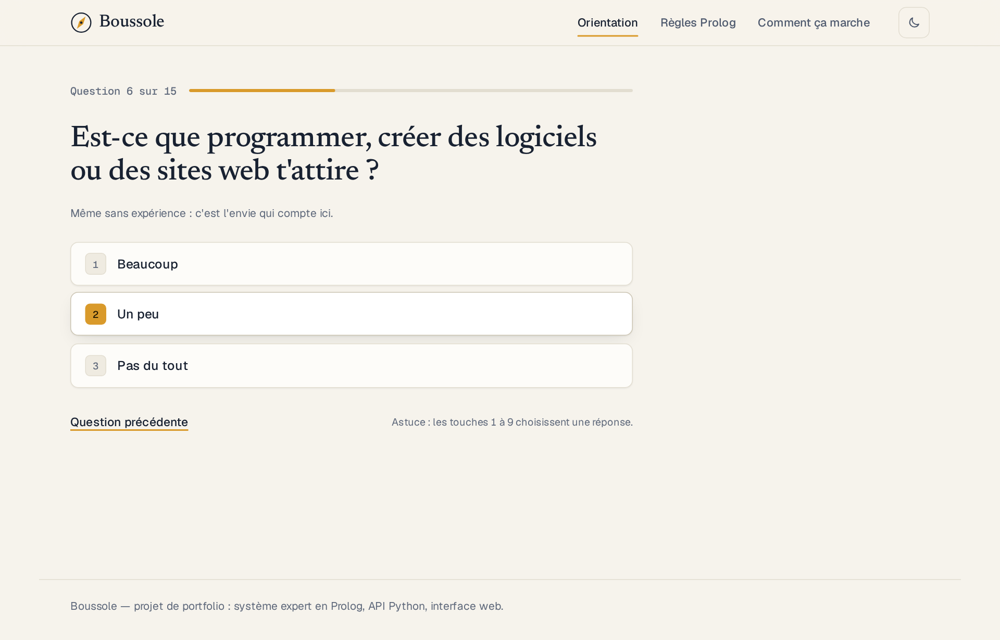
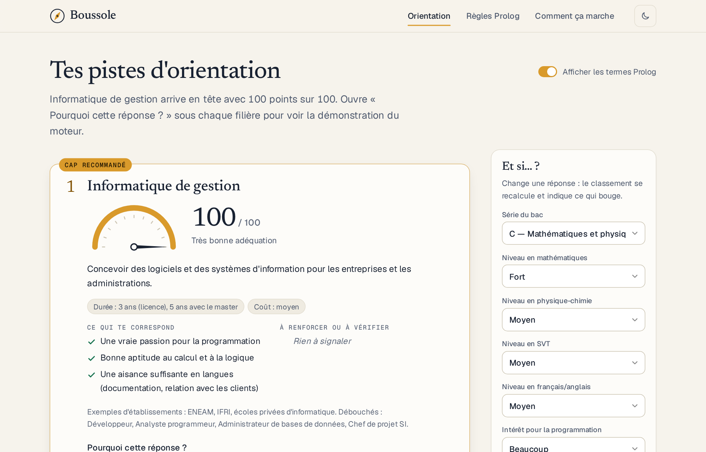
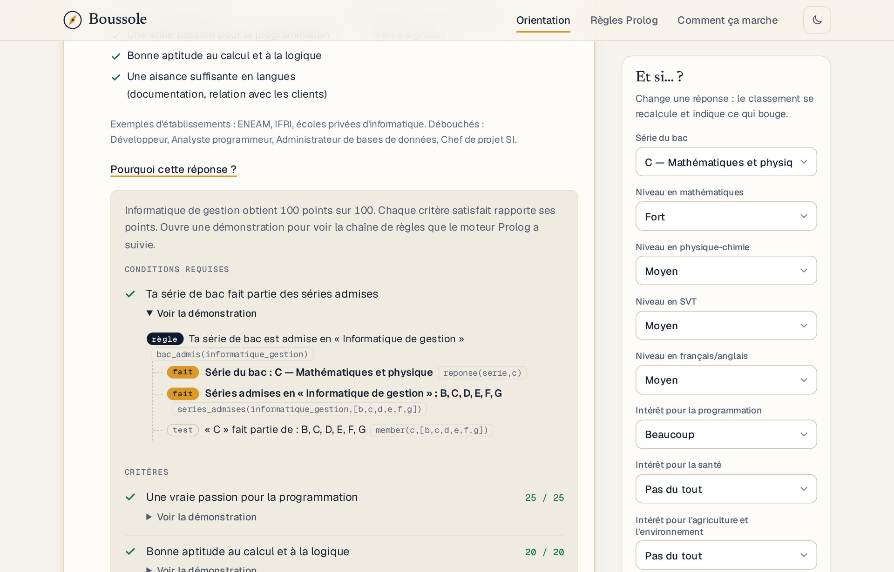
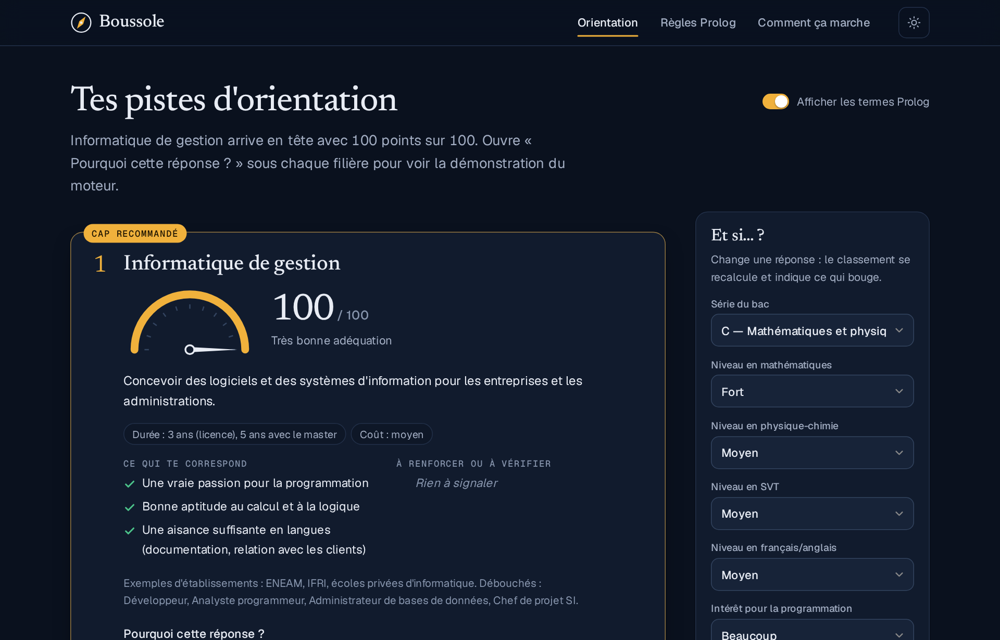

# Boussole — système expert d'orientation post-bac

[](../../actions/workflows/ci.yml)


Un système expert d'aide à l'orientation des bacheliers au Bénin. L'intelligence est une **base de règles Prolog** ; une petite **API Python (FastAPI)** la fait dialoguer avec une **interface web**. Chaque recommandation vient avec sa démonstration : « Pourquoi cette réponse ? ».

**[Voir la démo en ligne](https://boussole-b1v5.onrender.com/)**

| Questionnaire dynamique | Résultats et cadran |
|---|---|
|  |  |

| Arbre de preuve « Pourquoi ? » | Thème sombre |
|---|---|
|  |  |

## Ce que le projet démontre

- **IA symbolique** : raisonnement par règles, concepts intermédiaires (aptitudes, profil du bac), exigences éliminatoires et critères pondérés.
- **Explicabilité** : un **méta-interpréteur Prolog** (`prouve/2`) construit l'arbre de preuve de chaque décision, affiché dans l'interface.
- **Questionnaire dynamique** : une question n'est posée que si elle est pertinente (un bac G ne répond pas aux questions de physique).
- **Mode « et si ? »** : on change une réponse, le classement se recalcule et indique ce qui bouge.
- **Intégration propre** : pont Python ↔ Prolog par JSON, sans bibliothèque de liaison, validation stricte des entrées (une tentative d'injection Prolog est rejetée, cas couvert par les tests).
- **Interface soignée** : HTML/CSS/JS sans framework ni build, thème clair/sombre, navigation clavier, polices embarquées.
- **Tests** : plunit côté Prolog, pytest côté API, exécutés automatiquement par GitHub Actions.

## Architecture

```
Navigateur (HTML/CSS/JS)  ──fetch──▶  API Python (FastAPI)  ──JSON/stdin──▶  SWI-Prolog
 questionnaire, résultats,            validation, pont                       règles, inférence,
 arbre « pourquoi »                   vers Prolog                            méta-interpréteur
```

```
systeme-expert-orientation/
├── prolog/
│   ├── connaissances.pl   filières, règles, exigences, critères pondérés
│   ├── explication.pl     méta-interpréteur : arbre de preuve
│   ├── questions.pl       questionnaire dynamique
│   ├── textes.pl          phrases d'explication en français
│   ├── moteur.pl          point d'entrée JSON (stdin → stdout)
│   └── tests.pl           tests plunit
├── api/
│   ├── main.py            routes FastAPI + service des fichiers web
│   ├── moteur.py          pont Python ↔ Prolog
│   └── test_api.py        tests pytest
├── web/                   index.html, style.css, app.js, fonts/
├── design/                notes de conception de l'interface (audit, tokens, écrans)
├── docs/                  captures d'écran du README
├── .github/workflows/     intégration continue
├── Dockerfile
├── requirements.txt / requirements-dev.txt
└── README.md
```

## Choix techniques

- **Pourquoi Prolog** : les règles d'orientation sont des conditions logiques qu'un conseiller peut relire. Les écrire en Prolog les garde lisibles, séparées du code de l'application, et permet de montrer exactement ce qui a été déduit.
- **Pourquoi un méta-interpréteur** : Prolog sait répondre, mais pas expliquer. `prouve/2` rejoue la démonstration en gardant la trace des règles, faits et tests utilisés : c'est ce qui donne l'arbre « Pourquoi cette réponse ? ».
- **Pourquoi un pont JSON par stdin/stdout** plutôt que `pyswip` ou `janus` : aucune liaison native à compiler, même comportement sous Windows, Linux, macOS et Docker, et un moteur Prolog isolé dans son propre processus (délai maximal de 15 s). Le coût, environ 100 ms par appel, est assumé pour une démo.
- **Pourquoi pas de framework front** : l'interface se résume à un questionnaire et à des résultats. HTML/CSS/JS suffit, sans étape de build, et le tout est servi par la même application FastAPI.

## Comment raisonne le moteur

1. **Faits** : les réponses deviennent des faits `reponse(maths, fort)`.
2. **Règles intermédiaires** : par exemple

   ```prolog
   aptitude_calcul :- au_moins(maths, fort).
   aptitude_calcul :- au_moins(maths, moyen), bac_math.
   ```
3. **Exigences** (éliminatoires) : série du bac admise, études longues pour la médecine, etc. Une exigence manquante écarte la filière, avec la raison.
4. **Critères pondérés** : 100 points par filière (80 spécifiques + budget + durée). Un fort intérêt rapporte plus qu'un intérêt moyen.
5. **Explication** : `prouve/2` rejoue la démonstration en gardant la trace des règles, faits et tests utilisés.

## Lancer le projet (sans Docker)

### 1. Installer SWI-Prolog
- **Windows** : télécharger l'installateur sur <https://www.swi-prolog.org/Download.html> et **cocher « Add swipl to the PATH »**. Vérifier dans un nouveau terminal : `swipl --version`.
  Si `swipl` n'est pas dans le PATH, définir la variable d'environnement `SWIPL` avec le chemin complet, par exemple `C:\Program Files\swipl\bin\swipl.exe`.
- **Linux (Debian/Ubuntu)** : `sudo apt install swi-prolog-nox`
- **macOS** : `brew install swi-prolog`

### 2. Installer les dépendances Python
```bash
python -m venv .venv
# Windows : .venv\Scripts\activate      Linux/macOS : source .venv/bin/activate
pip install -r requirements.txt
```

### 3. Démarrer
```bash
uvicorn api.main:app --reload
```
Ouvrir <http://127.0.0.1:8000>. La documentation interactive de l'API est sur `/docs`.

## Tester le moteur Prolog seul

```bash
echo '{"action":"suivante","reponses":{"serie":"g"}}' | swipl -q -g main -t halt prolog/moteur.pl
```
(Sous Windows PowerShell, passer par un fichier : `Get-Content requete.json | swipl -q -g main -t halt prolog\moteur.pl`.)

## Tests

```bash
swipl -q -g run_tests -t halt prolog/tests.pl      # tests Prolog
pip install -r requirements-dev.txt
pytest -q                                          # tests de l'API
```

## Docker (pour le déploiement)

```bash
docker build -t boussole .
docker run -p 8000:8000 boussole
```
Le build exécute les tests Prolog : si la base de règles est cassée, l'image n'est pas construite.
Pour déployer sur Render, Railway ou Fly.io, pointer vers ce `Dockerfile` : la plateforme fournit la variable `PORT`, prise en compte automatiquement. L'image tourne en utilisateur non-root et déclare un `HEALTHCHECK` sur `/api/sante`.
Sur un plan gratuit, la première requête après une période d'inactivité peut prendre une trentaine de secondes (démarrage à froid).

L'API limite le débit à 60 requêtes par minute et par adresse IP (variable `BOUSSOLE_LIMITE_PAR_MINUTE`, `0` pour désactiver) et refuse les clés et valeurs de plus de 40 caractères.

## Limites assumées

- Les séries admises, coûts et durées sont **indicatifs et simplifiés**, à valider avec les conditions officielles.
- Le score mesure l'adéquation d'un profil, **pas les chances d'admission** (concours, quotas).
- Chaque appel lance un processus SWI-Prolog (environ 100 ms) : suffisant pour une démo. Pour un fort trafic, on passerait à un processus Prolog persistant (par exemple avec `janus`).

## Pistes d'amélioration

- Pondérations ajustables et validées avec des conseillers d'orientation.
- Ajout de la moyenne du bac et de contraintes géographiques.
- Export PDF de la fiche d'orientation avec les explications.
- Version anglaise de l'interface.

## Auteur

**Yu-on AHINDE** — analyste informatique et programmeur · [GitHub](https://github.com/Yu-on0123) · [Dépôt du projet](https://github.com/Yu-on0123/Boussole)

## Licence

Code sous licence [MIT](LICENSE) © Yu-on AHINDE. Les polices de `web/fonts/` sont sous licence SIL OFL 1.1 (voir [`web/fonts/LICENSES.md`](web/fonts/LICENSES.md)).
